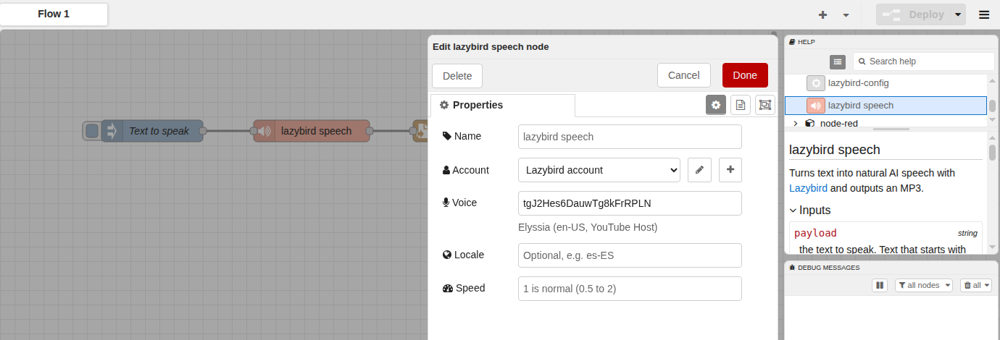

# @lazybirdai/node-red-lazybird

A [Node-RED](https://nodered.org) node for [Lazybird](https://www.lazybird.app). It turns text into natural AI speech (MP3) in your flows, for announcements, alerts, home automation, voiceovers and anything else that should talk.

Lazybird is an AI voiceover generator with 500+ voices in 150+ languages and accents, voice cloning, voice design and a [text to speech API](https://www.lazybird.app/text-to-speech-api).



## Install

In Node-RED, open **Menu → Manage palette → Install**, search for `@lazybirdai/node-red-lazybird` and click **Install**.

Or run this in your Node-RED user directory (usually `~/.node-red`) and restart Node-RED:

```sh
npm install @lazybirdai/node-red-lazybird
```

Requires Node-RED 3.1 or later and Node.js 18 or later.

## Set up your account

1. [Sign up for Lazybird](https://www.lazybird.app). The free plan includes 10,000 credits a month, no credit card needed.
2. Open [Studio settings](https://www.lazybird.app/studio/settings) and create an API key.
3. In Node-RED, add a **lazybird speech** node, click the pencil next to **Account**, paste the key and deploy.

The key is kept in Node-RED's encrypted credentials file, not in your flow.

## Usage

Send the text to speak in `msg.payload`. The node outputs the MP3 as a buffer in `msg.payload`, with `msg.contentType` set to `audio/mpeg`. Wire it to a **file** node to save it, to an **http response** node to serve it, or to any node that plays or uploads audio.

| Input | |
|---|---|
| `msg.payload` | The text to speak. Text that starts with `<speak>` is sent as SSML. |
| `msg.voice` | Optional voice ID, overrides the node's voice. |
| `msg.locale` | Optional language and accent, such as `es-ES` or `hi-IN`. Any voice can speak other languages. |
| `msg.speed` | Optional, 1 is normal speed (0.5 to 2). |
| `msg.settings` | Optional `pitch` (0.5 to 1.5), `volume` (0 to 2), and `style` and `styleIntensity` for voices with speaking styles. |

**Choosing a voice.** The voice field suggests Lazybird's library voices and your own voices. Type to search by name, language or style, or paste a voice ID. Deploy the account config node once so the list can load.

**SSML.** Use SSML for pauses and pronunciation:

```xml
<speak>Good morning. <break time="500ms"/> The front door is open.</speak>
```

**Errors.** Errors such as an invalid API key, an unknown voice or missing credits go to **catch** nodes, with a message that says what to fix.

**Example.** Import **Menu → Import → Examples → @lazybirdai/node-red-lazybird → save-speech-to-mp3** for a flow that saves speech to an MP3 file.

## Pricing

One credit is one character of text, shared between the Lazybird studio and the API. The free plan includes 10,000 credits a month; paid plans start at $9 a month and include commercial usage rights. See [pricing](https://www.lazybird.app/pricing).

## Resources

- [Lazybird docs](https://www.lazybird.app/docs)
- [Lazybird API reference](https://www.lazybird.app/docs/api-reference)
- [Changelog](https://github.com/lazybirdai/node-red-lazybird/blob/main/CHANGELOG.md)

## License

[MIT](LICENSE)
